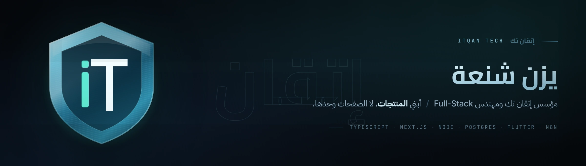
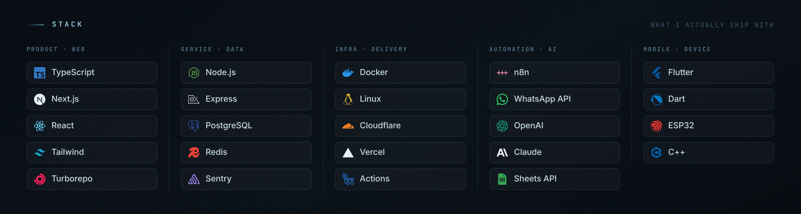
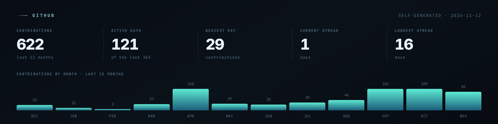

  <picture>
    <source media="(prefers-color-scheme: dark)"  srcset="assets/hero-ar-dark.webp">
    <source media="(prefers-color-scheme: light)" srcset="assets/hero-ar-light.webp">
    
  </picture>

  <a href="https://itqantech.io"><b>itqantech.io</b></a>
  &nbsp;·&nbsp;
  <a href="https://www.linkedin.com/in/yazan-shanaa-862977172">LinkedIn</a>
  &nbsp;·&nbsp;
  <a href="https://wa.me/972524623122">واتساب</a>
  &nbsp;·&nbsp;
  <a href="README.md">English</a>

 

طالب هندسة أنظمة حاسوب في **الجامعة العربية الأمريكية** في جنين، ومؤسس
**[إتقان تك](https://itqantech.io)** — استوديو في فلسطين يبني المواقع والمتاجر الإلكترونية
والأنظمة الداخلية لأصحاب المحلات في الضفة الغربية والمجتمعات العربية في الداخل.

معظم ما أعمل عليه ليس صفحات لعملاء، بل **منتجات أديرها من طرفها إلى طرفها**: منصات SaaS
متعددة المستأجرين أتولّى فيها البنية والنشر والمراجعة الأمنية والاشتراكات ومكالمات الدعم.
الإطلاق هو النصف السهل؛ أمّا إبقاء المنصة حيّة لتجّار يدفعون شهرياً فهو النصف الذي يعلّمك شيئاً.

 

## أبرز الأعمال

<table dir="rtl">
<tr>
<td width="50%" valign="top" align="right">

### سوق 48 &nbsp;<a href="https://souq48.shop">souq48.shop</a>

**منصة متاجر متعددة المستأجرين.** لكل تاجر متجره الخاص على نطاق فرعي أو نطاقه هو — قوالب،
سلة، طلبات، كوبونات، نقاط ولاء، ولوحة إحصائيات زوار يقرأها فعلاً.

أتولّى جانب المنصة: تفعيل الميزات لكل حساب، دورة حياة الاشتراك، ربط النطاقات، لوحة الـ SEO،
والمصادقة الثنائية. صفر عمولة على مبيعات التاجر، وتصدير كامل لبياناته متى أراد.

`Next.js` `TypeScript` `PostgreSQL` `Redis` `Docker` `n8n`

</td>
<td width="50%" valign="top" align="right">

### وسيط &nbsp;<a href="https://wasetapp.store">wasetapp.store</a>

**منصة SaaS لوسطاء التسوّق أونلاين** — من يشترون من شي إن وتيمو وأمازون وعلي إكسبرس
نيابةً عن الزبائن.

إدخال الطلبات، حاسبة السعر الواصل، تجميع الطلبات في شحنات مشتركة مع تقسيم الشحن والجمارك،
صفحات تتبّع للزبائن، ودليل وسطاء حسب المدينة. بيانات كل وسيط تُحفظ في
**ملف Google Sheets داخل درايفه هو**، لا على خوادمنا.

`TypeScript` `Next.js` `Google Sheets API` `OAuth`

</td>
</tr>
<tr>
<td width="50%" valign="top" align="right">

### إتقان سيستم

**نظام تشغيل الشركة الداخلي.** لوحة واحدة بدل ثماني تبويبات.

صلاحيات على مستوى الحقل (بما فيها الإدخال الأعمى — موظف يضيف سجلاً دون أن يرى ما قبله)،
محاسبة بقيد مزدوج، إدارة عملاء وصفقات، سجل مشاريع، وسجل مورّدين واشتراكات. سوق 48 ووسيط
يتصلان به عبر API ويبقيان مستقلّين بكودهما.

`TypeScript` `Next.js` `PostgreSQL` `RBAC`

</td>
<td width="50%" valign="top" align="right">

### القابس الذكي &nbsp;مشروع التخرج

**حيث يلتقي العتاد بالتطبيق.** قابس ذكي مبني على ESP32 مع تطبيق تحكّم بـ Flutter — جدولة
وتشغيل وحالة لحظية عبر الشبكة.

البرمجية الثابتة بلغة C++ على الـ ESP32، والتطبيق بـ Dart/Flutter. بُني ونوقش كمشروع تخرج
في هندسة أنظمة الحاسوب.

`C++` `ESP32` `Flutter` `Dart`

</td>
</tr>
<tr>
<td width="50%" valign="top" align="right">

### ميزان

**تطبيق محاسبة.** مستودع أحادي بـ Turborepo و pnpm — بنية `apps/` و `packages/`، و Docker
Compose، و PostgreSQL — مبني على قيد مزدوج صحيح بدل أكوام الجداول.

`TypeScript` `Turborepo` `pnpm` `PostgreSQL` `Docker`

</td>
<td width="50%" valign="top" align="right">

### آفاق للطاقة الشمسية &nbsp;عميل

**موقع شركة طاقة شمسية** مع حاسبة تحديد حجم النظام: يُدخل صاحب البيت استهلاكه فيحصل على
تقدير للألواح والعاكس والبطاريات قبل أن يرفع أحد سمّاعة الهاتف.

منشور على Vercel.

`TypeScript` `Next.js` `Vercel`

</td>
</tr>
</table>

 

## التقنيات

<picture>
  <source media="(prefers-color-scheme: dark)"  srcset="assets/stack-dark.webp">
  <source media="(prefers-color-scheme: light)" srcset="assets/stack-light.webp">
  
</picture>

 

## على الطاولة أيضاً

**كاميرات رؤية بالذكاء الاصطناعي** — كاميرات قابلة للبرمجة والتدريب لأرضيات المصانع والمطاعم.
**صيّاد العملاء** — وحدة التنقيب عن العملاء داخل إتقان سيستم.
**أتمتة واتساب** — مسارات n8n ومساعدون أذكياء يردّون ويسعّرون ويسجّلون الطلبات للأعمال التي
تعيش على واتساب.

## GitHub

<picture>
  <source media="(prefers-color-scheme: dark)"  srcset="assets/github-dark.webp">
  <source media="(prefers-color-scheme: light)" srcset="assets/github-light.webp">
  
</picture>

<picture>
  <source media="(prefers-color-scheme: dark)"  srcset="https://raw.githubusercontent.com/yazanshanaa/yazanshanaa/output/snake-dark.svg">
  
</picture>

الرسمان يتولّدان يومياً عبر GitHub Action داخل هذا المستودع — بلا خدمة إحصائيات خارجية، فلا شيء يتعطّل.

 

## للعمل معي

إتقان تك تبني المواقع والمتاجر الإلكترونية وأنظمة الحجز والإدارة وتطبيقات الجوال وأتمتة
واتساب — بأسعار معلنة، فتعرف الرقم قبل أن تكلّم أحداً.

  <a href="https://itqantech.io/pricing"><b>الأسعار ←</b></a>
  &nbsp;&nbsp;
  <a href="https://itqantech.io/demos/clothing">نموذج متجر</a>
  &nbsp;·&nbsp;
  <a href="https://itqantech.io/demos/restaurant">نموذج مطعم</a>
  &nbsp;·&nbsp;
  <a href="https://wa.me/972524623122">واتساب</a>

  <a href="https://www.facebook.com/itqantech1">فيسبوك</a> ·
  <a href="https://www.instagram.com/itqantec/">إنستغرام</a> ·
  <a href="https://www.tiktok.com/@itqantech0">تيك توك</a> ·
  <a href="https://www.linkedin.com/company/itqantech1">صفحة الشركة</a>

