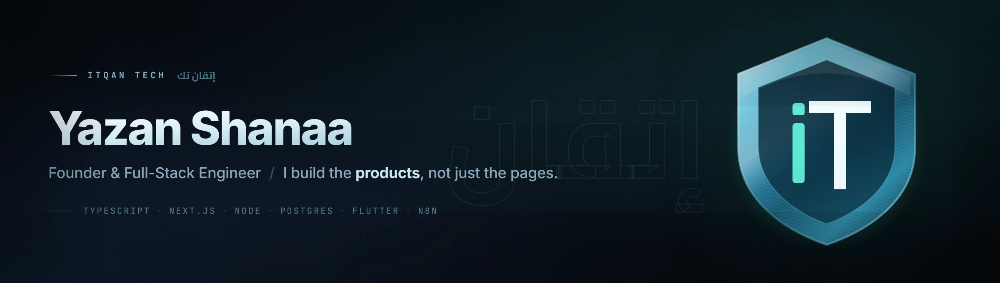
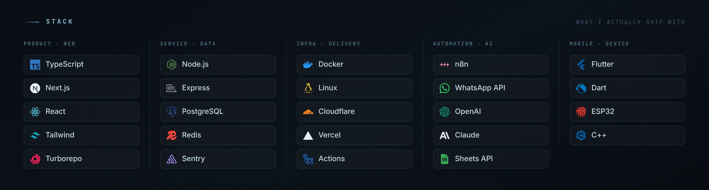
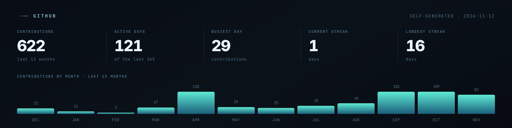

  <picture>
    <source media="(prefers-color-scheme: dark)"  srcset="assets/hero-dark.webp">
    <source media="(prefers-color-scheme: light)" srcset="assets/hero-light.webp">
    
  </picture>

  <a href="https://itqantech.io"><b>itqantech.io</b></a>
  &nbsp;·&nbsp;
  <a href="https://www.linkedin.com/in/yazan-shanaa-862977172">LinkedIn</a>
  &nbsp;·&nbsp;
  <a href="https://wa.me/972524623122">WhatsApp</a>
  &nbsp;·&nbsp;
  <a href="README.ar.md">العربية</a>

 

Computer Systems Engineering student at the **Arab American University** in Jenin, and founder of
**[Itqan Tech](https://itqantech.io)** — a studio in Palestine building websites, online stores and
internal systems for shops across the West Bank and Arab communities inside Israel.

Most of what I do isn't client pages — it's **products I run end to end**: multi-tenant SaaS
platforms where I own the architecture, the deployment, the security review, the subscriptions
and the support calls. Shipping is the easy half; keeping a platform alive for paying merchants
is the half that teaches you something.

 

## Featured work

<table>
<tr>
<td width="50%" valign="top">

### Souq&nbsp;48 &nbsp;<a href="https://souq48.shop">souq48.shop</a>

**Multi-tenant store platform.** Every merchant gets their own storefront on a subdomain or
their own domain — templates, cart, orders, coupons, loyalty points and a visitor-analytics
panel they actually read.

I run the platform side: per-tenant feature toggles, subscription lifecycle, domain binding,
SEO panel and 2FA. Zero commission on merchant sales, full data export on exit.

`Next.js` `TypeScript` `PostgreSQL` `Redis` `Docker` `n8n`

</td>
<td width="50%" valign="top">

### Waset &nbsp;<a href="https://wasetapp.store">wasetapp.store</a>

**SaaS for online-shopping brokers** — the people who buy from SHEIN, Temu, Amazon and
AliExpress on behalf of customers.

Order intake, a landed-price calculator, grouped shipments that split shipping and customs
across orders, customer tracking pages, and a broker directory by city. Each broker's data
lives in **their own Google Drive sheet**, not on our servers.

`TypeScript` `Next.js` `Google Sheets API` `OAuth`

</td>
</tr>
<tr>
<td width="50%" valign="top">

### Itqan System

**The company's internal operating system.** One dashboard instead of eight tabs.

Field-level permissions (including blind entry — a clerk can add a record without reading
what's already there), double-entry accounting, CRM and deal pipeline, project registry, and
a vendor/subscription register. Souq&nbsp;48 and Waset connect to it over API and stay
independent codebases.

`TypeScript` `Next.js` `PostgreSQL` `RBAC`

</td>
<td width="50%" valign="top">

### Smart Plug &nbsp;graduation project

**Hardware meets mobile.** An ESP32-based smart plug with a Flutter control app — scheduling,
switching and live state, over the network.

Firmware in C++ on the ESP32, the app in Dart/Flutter. Built and defended as my Computer
Systems Engineering final project.

`C++` `ESP32` `Flutter` `Dart`

</td>
</tr>
<tr>
<td width="50%" valign="top">

### MIZAN

**Accounting application.** A Turborepo + pnpm monorepo — `apps/` and `packages/`, Docker
Compose, PostgreSQL — built around proper double-entry bookkeeping rather than a pile of
spreadsheets.

`TypeScript` `Turborepo` `pnpm` `PostgreSQL` `Docker`

</td>
<td width="50%" valign="top">

### AFAQ Solar &nbsp;client

**Solar-energy company site** with a system-sizing calculator: a homeowner enters their
consumption and gets a panel, inverter and battery estimate before anyone picks up the phone.

Deployed on Vercel.

`TypeScript` `Next.js` `Vercel`

</td>
</tr>
</table>

 

## Stack

<picture>
  <source media="(prefers-color-scheme: dark)"  srcset="assets/stack-dark.webp">
  <source media="(prefers-color-scheme: light)" srcset="assets/stack-light.webp">
  
</picture>

 

## Also on my desk

**AI vision cameras** — programmable cameras trained for factory and restaurant floor use.
**Lead Hunter** — the prospecting module inside Itqan System.
**WhatsApp automation** — n8n flows and AI assistants that answer, quote and record orders
for businesses that live on WhatsApp.

 

## GitHub

<picture>
  <source media="(prefers-color-scheme: dark)"  srcset="assets/github-dark.webp">
  <source media="(prefers-color-scheme: light)" srcset="assets/github-light.webp">
  
</picture>

<picture>
  <source media="(prefers-color-scheme: dark)"  srcset="https://raw.githubusercontent.com/yazanshanaa/yazanshanaa/output/snake-dark.svg">
  
</picture>

Both graphics are regenerated daily by a GitHub Action in this repository — no third-party stats service, nothing to go down.

 

## Work with me

Itqan Tech builds websites, online stores, booking and management systems, mobile apps and
WhatsApp automation — at published prices, so you know the number before you talk to anyone.

  <a href="https://itqantech.io/pricing"><b>Pricing →</b></a>
  &nbsp;&nbsp;
  <a href="https://itqantech.io/demos/clothing">Store demo</a>
  &nbsp;·&nbsp;
  <a href="https://itqantech.io/demos/restaurant">Restaurant demo</a>
  &nbsp;·&nbsp;
  <a href="https://wa.me/972524623122">WhatsApp</a>

  <a href="https://www.facebook.com/itqantech1">Facebook</a> ·
  <a href="https://www.instagram.com/itqantec/">Instagram</a> ·
  <a href="https://www.tiktok.com/@itqantech0">TikTok</a> ·
  <a href="https://www.linkedin.com/company/itqantech1">Company page</a>

